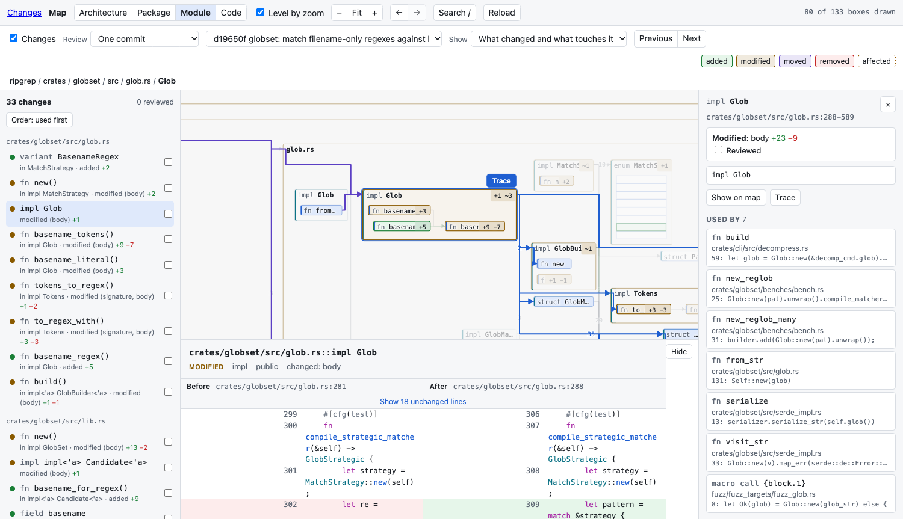
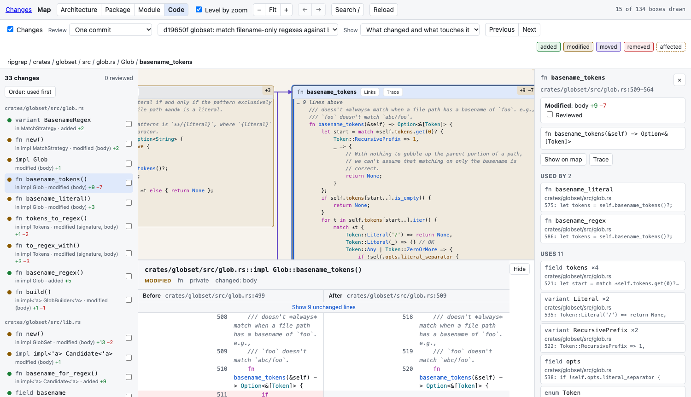
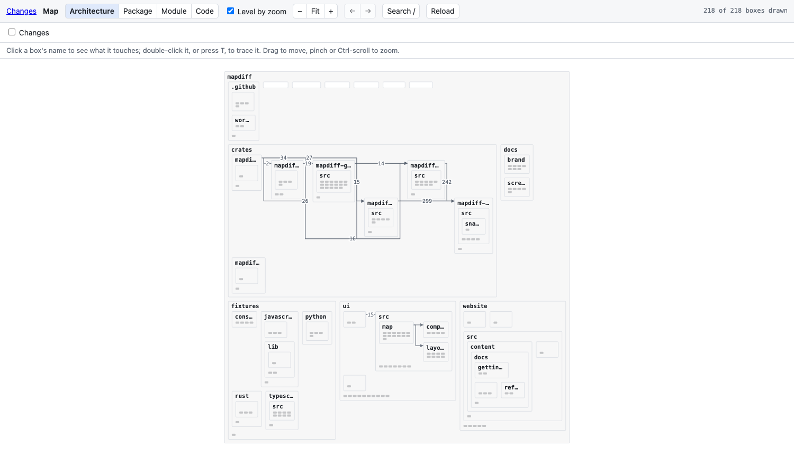
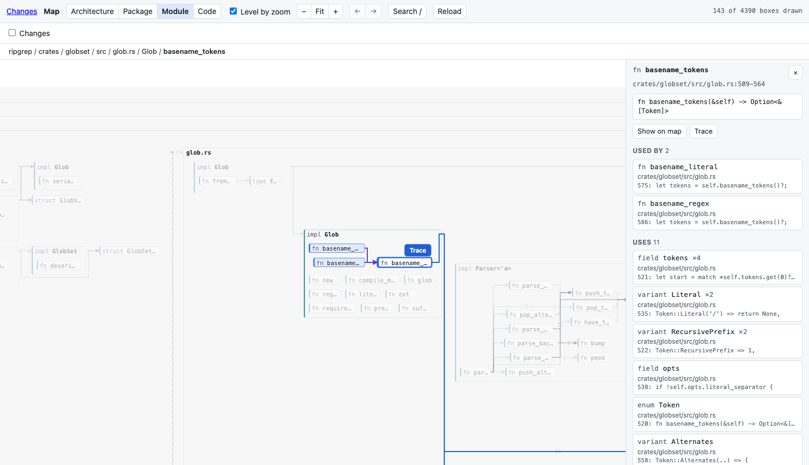
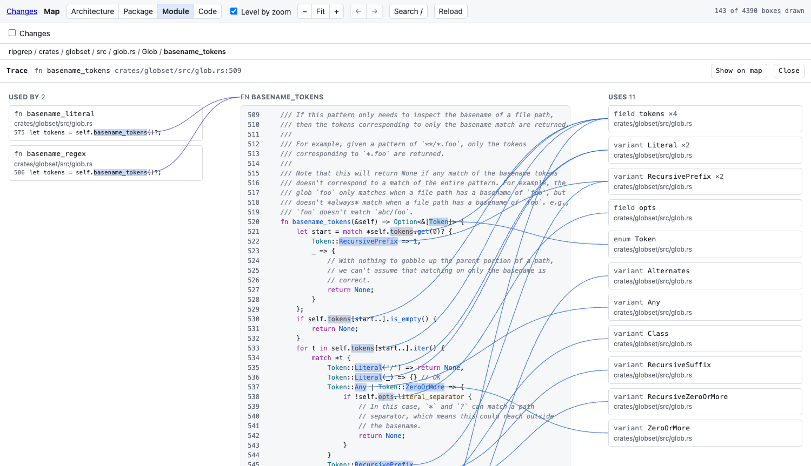

<br />
<p align="center">
  
</p>

<h3><p align="center">Review a change on a map of your code</p></h3>

<h4><p align="center">
<a href="#install">[Install]</a>
- <a href="#quick-start">[Quick start]</a>
- <a href="#reviewing-a-change">[Review]</a>
- <a href="#the-map">[Map]</a>
- <a href="https://avgvi.github.io/mapdiff/">[Docs]</a>
- <a href="CHANGELOG.md">[Changelog]</a>
</p></h4>

<p align="center">
  <a href="https://crates.io/crates/mapdiff"></a>
  <a href="https://github.com/avgvi/mapdiff/actions/workflows/ci.yml"></a>
  
  
  <a href="LICENSE"></a>
</p>
<br />

A diff shows you lines. `mapdiff` shows you the functions and types that changed, where they sit in the codebase, and the code that uses them. Run it in a repository and it opens in your browser.



- **The change as code, not lines.** "This function's signature changed", "this type moved there", with before and after side by side.
- **What it touches.** Unchanged code that uses something you removed or renamed is marked. A line diff has no place for it.
- **A sensible order.** What is used comes before what uses it. One keypress per change.
- **One command.** `mapdiff` in any git repository. There is nothing to set up.

## Install

Pick one. Each installs the `mapdiff` command.

### Homebrew

macOS and Linux.

```bash
brew install avgvi/tap/mapdiff
```

### Shell installer

A prebuilt binary for macOS or Linux, arm64 or x86_64.

```bash
curl --proto '=https' --tlsv1.2 -LsSf https://github.com/avgvi/mapdiff/releases/latest/download/mapdiff-installer.sh | sh
```

### Cargo

```bash
cargo install mapdiff
```

That builds from source. To download the release binary instead:

```bash
cargo binstall mapdiff
```

### npm

```bash
npm install -g mapdiff-cli
```

The package is called `mapdiff-cli` on npm; the command it installs is still `mapdiff`.

### Python tools

```bash
uv tool install mapdiff
```

With pipx it is `pipx install mapdiff`.

### From source

With Rust and Node installed:

```bash
git clone https://github.com/avgvi/mapdiff && cd mapdiff
cd ui && npm ci && npm run build && cd ..   # builds the page, which goes inside the binary
cargo install --path crates/mapdiff-cli     # installs `mapdiff`
```

## Quick start

In any git repository:

```bash
mapdiff                  # the map, with your uncommitted changes drawn on it
mapdiff main...HEAD      # what this branch changed
mapdiff --commit HEAD    # one commit
mapdiff --pr 123         # a GitHub pull request
```

Then press `N` to go to the first change, `R` when you have read it, and `N` again.

## Reviewing a change

| On the map | Means |
|---|---|
| Green | Added |
| Amber | Modified |
| Purple | Moved, with a line from where it was |
| Red | Removed |
| Dashed border | Unchanged, but uses something that changed |

`N` and `P` step through the changes, and each one opens its before and after under the map. `R` marks it reviewed.

On a large change, **Only what changed** cuts the map down to it. One commit of ripgrep goes from 4,390 boxes to 7.



More in the [review guide](https://avgvi.github.io/mapdiff/guides/review/).

## The map

Untick **Changes** and the map is a way to read a codebase, at four levels:

| Key | Level | Shows |
|---|---|---|
| `1` | Architecture | Directories and the wires between them |
| `2` | Package | Files |
| `3` | Module | Types and functions |
| `4` | Code | The text of every function |



**Click a box** to see who uses it and what it uses, with a path drawn to each.



**Press `T`** to trace it: its code in the middle, callers on the left, what it calls on the right.



**Press `/`** to find a function, type or file by a few letters. All the [keys](https://avgvi.github.io/mapdiff/guides/keys/) are in the docs.

## Languages

Rust, Python, TypeScript and JavaScript.

References are found by name out of the box. `mapdiff --index` also runs the language's own indexer (rust-analyzer, scip-typescript, scip-python) in the background, to add methods called on a value. Tests are left off the map, and a changed test still shows in a review. [More on languages](https://avgvi.github.io/mapdiff/reference/languages/).

## In the terminal

What the page shows is also a command, most with `--json`:

```bash
mapdiff diff main...HEAD              # the change, by function and type
mapdiff impact --commit HEAD          # unchanged code that uses what the commit altered
mapdiff refs 'src/lib.rs::parse()'    # what uses a function, and what it uses
```

Each `mapdiff` you start runs until Ctrl-C. From any terminal:

```bash
mapdiff list          # what is running, and where
mapdiff stop          # stop the one for this repository (--all for every one)
mapdiff clean         # stop them all and remove everything mapdiff has written
```

The rest are in the [command reference](https://avgvi.github.io/mapdiff/reference/cli/).

## Development

```bash
.github/scripts/fetch-repos.sh    # four pinned open-source repositories, used as test data
cargo test                        # Rust tests
cd ui && npm test                 # layout and viewer tests
```

| Path | Holds |
|---|---|
| `crates/` | The `mapdiff` command: parsing, changes, the reference graph, the local server |
| `ui/` | The page: React and TypeScript, with elkjs for layout |
| `website/` | The docs site |

## Licence

[MIT](LICENSE)
