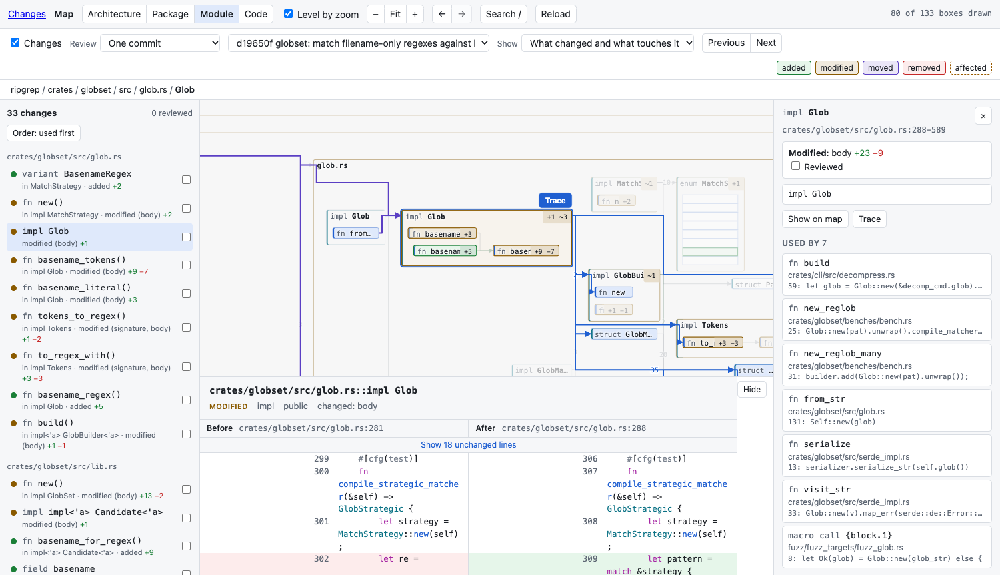
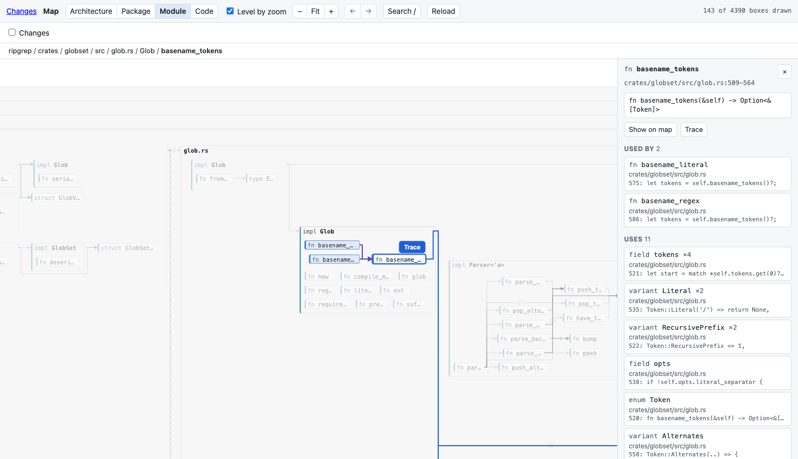

mapdiff is one command. Run it inside a git repository and it opens a map of that repository in your browser.

## The four ways to start it

```bash
mapdiff                  # the map, with your uncommitted changes drawn on it
mapdiff main...HEAD      # what this branch changed since it left main
mapdiff --commit HEAD    # one commit
mapdiff --pr 123         # a GitHub pull request, fetched from origin
```

That is all there is to running it. It prints an address, opens it, and runs until you press Ctrl-C.

If the repository has no uncommitted changes, plain `mapdiff` opens the map with nothing drawn on it.

## Your first review



Say you are on a branch and want to read what it changed:

```bash
mapdiff main...HEAD
```

1. **Look at the map.** Coloured boxes are what changed: green added, amber modified, purple moved, red removed. Containers show how many changed things they hold.
2. **Press `N`.** The map moves to the first change, and its before and after open under the map. The order is chosen for reading: what is used comes before what uses it.
3. **Read it, press `R`** to mark it reviewed, **press `N`** for the next. The list on the left shows how far along you are.
4. **Look for dashed borders.** Those are functions that did not change but use something that did: removed, renamed, moved, or with a new signature.

Two things that help on a large change:

- **Show: Only what changed** (in the bar above the map) shrinks the map to just the changed parts.
- **`3` and `4`** show more detail: functions, then their code. `1` and `2` show less.

## Your first look around

Without a change drawn, the map is for reading code:

```bash
mapdiff
```

Untick **Changes** if it is on. Then:

- Press `/` and type a few letters of a function's name. Enter jumps to it.
- Click a box (or, when it shows code, its title bar). The map lights up who uses it and what it uses; the panel on the right lists them.
- Press `T` to trace it: its code in the middle, callers on the left, what it calls on the right.



## Where to go next

- [Reviewing a change](../../guides/review/)
- [The map](../../guides/map/)
- [Keys](../../guides/keys/)
