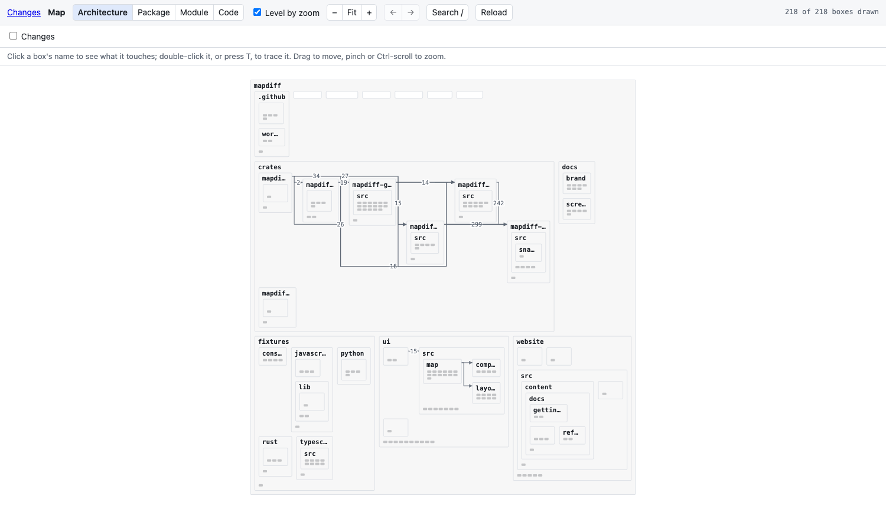
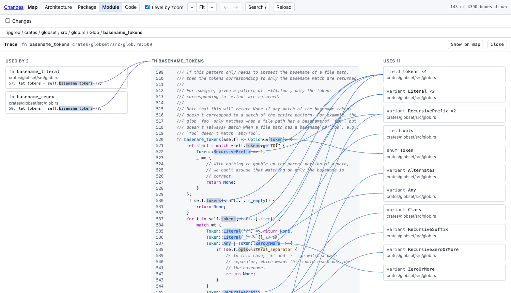

```bash
mapdiff
```

Untick **Changes** to see the repository as it is, with nothing drawn over it.

## Reading it

Boxes are code: a directory holds files, a file holds types and functions, a type holds its members. A wire runs from what uses to what is used, and the layout flows the same way, left to right. A number on a wire is how many references it stands for.

| Wire | Means |
|---|---|
| Solid, with an arrowhead | Uses |
| Dashed, in another colour | Uses, but against the flow: this wire closes a loop |

The bar above the map says how the wires were found: **References: by name** or **by type**. By name misses methods called on a value; **Index** next to it adds them. See [languages and references](../../reference/languages/).

## Levels



| Level | Key | Shows |
|---|---|---|
| Architecture | `1` | Directories and the wires between them. Files are small marks |
| Package | `2` | Files |
| Module | `3` | Types and functions |
| Code | `4` | The text of every function |

Zooming far in on a box that only shows its title opens the next level around it. Zooming far out goes back. Untick **Level by zoom** to switch only by key.

## Selecting

Click a box. When a box shows code, click its title bar (clicking the code selects text). The map then:

- lights the boxes that use it and the boxes it uses,
- draws a path to each, across files and directories,
- dims everything else.

The panel on the right has the same as two lists, **Used by** and **Uses**, with the line where each use happens. Click one to go there.

## Trace

`T`, the **Trace** button, or a double-click on a title. One function in the middle, its callers on the left with the lines that call it, what it calls on the right, and a curve from each name in the code to what it refers to. Click a card to trace that one.



## Finding things

`/` or Cmd-K, then a few letters: `wkb` finds `WalkBuilder`. Enter jumps to it and changes level if the map is not showing that kind of thing. `[` and `]` go back and forward through what you selected.

## Long functions

A code box shows 40 lines. Its last line, `… 21 more lines (show all)`, opens the rest in place. For anything long, Trace is the better place to read.
