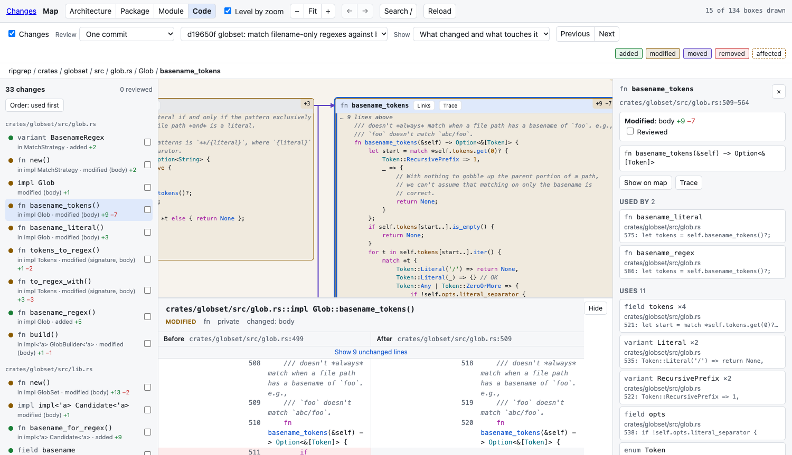

```bash
mapdiff main...HEAD      # a branch against where it left main
mapdiff --commit abc123  # one commit
mapdiff --staged         # what is staged
mapdiff --pr 123         # a GitHub pull request
mapdiff                  # your uncommitted changes
```

You can also change what is being reviewed in the page, with the **Review** menu.

## What the colours mean



| On the map | Means |
|---|---|
| Green | Added |
| Amber | Modified or renamed |
| Purple | Moved. It appears twice, where it was and where it is, joined by a dashed line |
| Red, dashed border | Removed. It stays where it was, as a ghost |
| Amber border, no fill | Holds changes, but did not change as a whole |
| Dashed border | Affected: unchanged, but uses something whose change it can see |
| Blue border | Touches a change: uses, or is used by, something that changed |

A box with one change shows its lines (`+4 −2`). A container shows how many things changed inside it: `+2 ~3 →1 −1` is two added, three modified, one moved, one removed.

## Stepping through

The list on the left has every change, grouped by file. `N` goes to the next, `P` to the previous; clicking a row goes straight to it. The map moves to the change and its before and after open under the map (`D` hides and shows that panel).

The order is made for reading:

1. What is used comes before what uses it, so you read a function before its caller.
2. Changes in one file stay together.
3. Code first, then tests, then prose such as a changelog.

**Order: used first** at the top of the list flips it to callers first.

## Review marks

`R`, or the checkbox on a row, marks a change reviewed. Reviewed boxes fade and get a tick, and containers show progress (`3/5 ✓`). Marks are kept in `.git/mapdiff/reviewed.json`, so they survive a restart. Editing the code again clears the mark for that change.

## Affected code

A dashed border means: this did not change, but it uses something that was removed, renamed or moved, or whose signature or access changed. Select it and the panel on the right says which change, and why.

A line diff has no place for this, because affected code is not in the diff. `mapdiff impact` prints the same list in the terminal.

A changed body affects nobody: only changes a caller can see are counted.

## Less map

**Show**, above the map:

| Choice | Keeps |
|---|---|
| The whole map | Everything |
| Only what changed | Changed boxes and what holds them |
| What changed and what touches it | Also unchanged code that uses, or is used by, a change |

The smaller map is laid out afresh, so a change spread over a large repository fits on a screen.

## Pull requests

`mapdiff --pr 123` fetches the pull request from `origin` and opens it. It keeps two refs under `refs/mapdiff/pr/`. If the `gh` command is installed and signed in, mapdiff asks it for the pull request's base branch and title; otherwise it assumes the default branch.

## Tests

Tests are not on the map, but a changed test is still part of the review: it is listed in its own group after the code, and its before and after open like any other.
