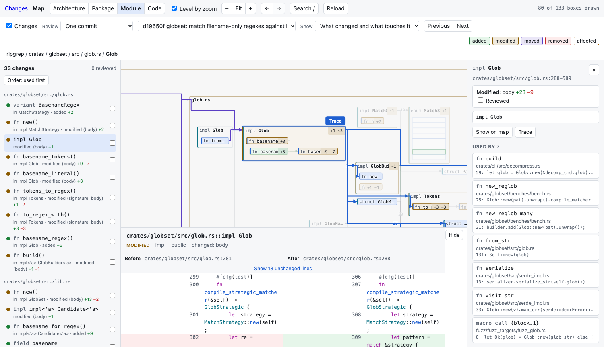

import { Card, CardGrid } from '@astrojs/starlight/components';

<CardGrid>
	<Card title="The change as code" icon="seti:json">
		"This function's signature changed", "this type moved there", with before
		and after side by side. See [reviewing a change](guides/review/).
	</Card>
	<Card title="What it touches" icon="warning">
		Unchanged code that uses something you removed, renamed or re-signed is
		marked on the map. A line diff has no place for it.
	</Card>
	<Card title="A sensible order" icon="list-format">
		What is used comes before what uses it, code before tests, one keypress
		per change. `N` for the next, `R` when you have read it.
	</Card>
	<Card title="A map of the whole repository" icon="open-book">
		Four [levels](guides/map/), from directories down to the text of every
		function. Click one to see who uses it and what it uses.
	</Card>
	<Card title="One command" icon="rocket">
		`mapdiff`, `mapdiff main...HEAD`, `mapdiff --pr 123`. Each opens the map
		in your browser. See the [quick start](getting-started/quick-start/).
	</Card>
	<Card title="Four languages" icon="puzzle">
		Rust, Python, TypeScript and JavaScript, with [references by
		type](reference/languages/) when the language's indexer is installed.
	</Card>
</CardGrid>
